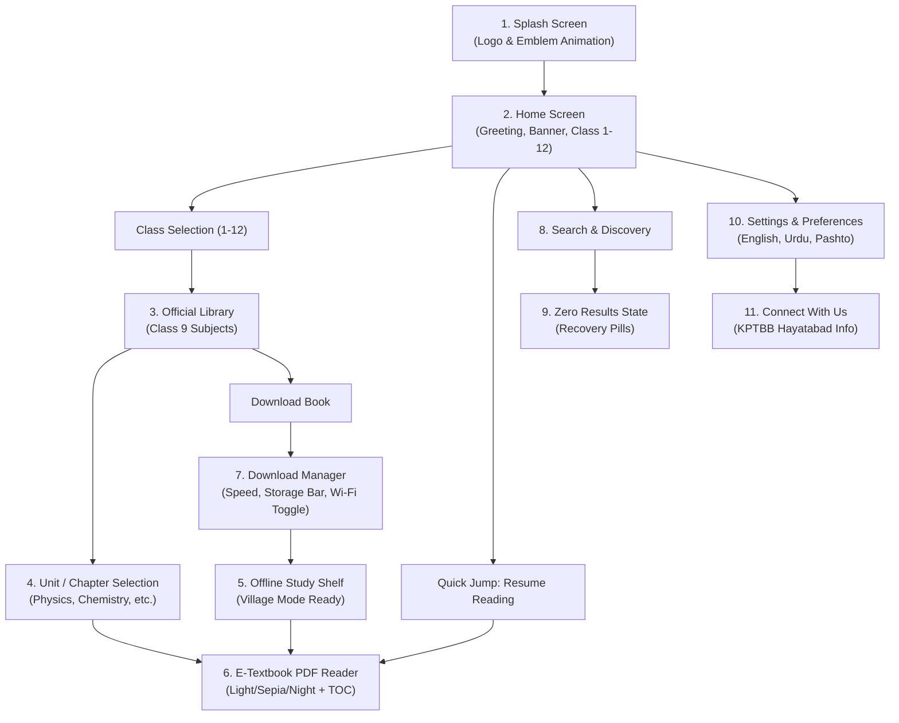

# Pakhtunkhwa Ilm (KPK E-Textbooks) — Complete Technical Documentation

> **Official Mobile Application for the Khyber Pakhtunkhwa Textbook Board (KPTBB)**  
> **Elementary & Secondary Education Department, Government of Khyber Pakhtunkhwa**  
> *Engineered in Flutter & Dart from Google Stitch Design Specifications*

---

## 1. Executive Summary & Vision

**Pakhtunkhwa Ilm (KPK E-Textbooks)** is a high-fidelity, offline-first mobile learning application tailored for students, teachers, and parents across Khyber Pakhtunkhwa. 

Due to uneven internet connectivity across regional terrains, the app is engineered around **"Village Study Mode"**—a 100% offline-first architecture where textbooks and study materials can be downloaded once and accessed indefinitely without active mobile data or cellular reception.

### Core Objectives:
* **Universal Access:** Curriculum from Class 1 to Class 12 (Primary, Middle, Matric, and Intermediate).
* **Zero Connectivity Friction:** Instant offline access to reading materials, model papers, and syllabus guides.
* **Modern Material 3 UX:** Cultural identity reflected through deep forest green hues (`#005129`), crisp typography, and intuitive touch targets.
* **Official Authenticity:** Verified textbooks conforming to the latest Curriculum 2024–25 standards.

---

## 2. Technical Stack & Architecture

| Layer | Technology | Details |
|---|---|---|
| **Framework** | **Flutter 3.35.6** | Cross-platform UI toolkit (Android, Web, Windows) |
| **Language** | **Dart 3.9.2** | Sound null safety, modern asynchronous streams |
| **State Management** | **Provider 6.1.5** | Reactive, clean architecture with `AppState` |
| **Typography** | **Google Fonts 8.1.0** | *Plus Jakarta Sans* (Headings) & *Inter* (Body/Meta) |
| **Target Platforms** | Android (APK Built), Chrome Web, Windows Desktop | Production APK verified: `KPK_E_Textbooks.apk` (48.2 MB) |
| **Design Engine** | Material 3 Tokens | Custom color tokens and 8dp baseline grid |

---

## 3. Design System & Theme Specifications

The visual identity is based on the Stitch specification file (`pakhtunkhwa_ilm/DESIGN.md`), balancing government authenticity with modern EdTech ergonomics.

```
       [ Deep Forest Green ]         [ Emerald Green ]          [ Warm Mint Surface ]
            #005129                      #006D3F                     #EFFDF3
      (Primary App Bars)          (CTAs & Active States)        (Eye-friendly Canvas)
```

### Color Palette Tokens (`lib/theme/app_colors.dart`):
* **Primary (`#005129` / `#086B3A`):** Anchors headers, official badges, and authoritative indicators.
* **Secondary (`#006D3F` / `#8AF9B4`):** Primary action buttons, download progress bars, and active tabs.
* **Tertiary / Amber (`#5B4200` / `#FFD06F`):** Bookmarks, exam preparation tags, and achievement badges.
* **Surface Canvas (`#EFFDF3` / `#F8FAF7`):** Soft, soothing background preventing ocular fatigue during prolonged study sessions.
* **Surface Containers (`#FFFFFF`):** High-contrast pure white surfaces for textbook cards, reading viewport, and dialogs.

---

## 4. Detailed Screen Breakdown (All 11 Modules)



---

### Screen 1: Splash Screen (`lib/screens/splash_screen.dart`)
* **Purpose:** Initial entry point displaying official branding and initializing state.
* **Key Components:**
  * Official Logo (`assets/images/app_logo.png`) housed in a 120x120 elevated rounded card.
  * Title: *"KPK E-Textbooks"* with Urdu subtitle *"خیبر پختونخوا ای-ٹیکسٹ بکس"*.
  * Animated transition using `AnimationController` and `CurvedAnimation`.
  * Auto-transition timer (2.6s) with manual "Tap to Enter" button.

### Screen 2: Home Screen (`lib/screens/home_screen.dart`)
* **Purpose:** Central student dashboard for continuing studies and exploring subjects.
* **Key Components:**
  * **Greeting Banner:** Personalized welcome (*"Assalam-o-Alaikum! 👋"*).
  * **Live Search Trigger:** Direct tap opens search discovery.
  * **Mid-term Exams Banner:** Gradient card highlighting Curriculum 2024–25 model papers.
  * **Quick Jump Session:** Resume reading card showing last studied textbook and page (*"Resume • Pg 82"*).
  * **Class 1 to 12 Selection Grid:** 4-column responsive grid allowing 1-tap switching between grades.
  * **Featured Books Grid:** Dynamic cards displaying popular textbooks for the selected class.

### Screen 3: Official Library (`lib/screens/library_screen.dart`)
* **Purpose:** Complete catalog of textbooks for the active class.
* **Key Components:**
  * **Class Dropdown Selector:** Header dropdown to switch between Class 1 through 12.
  * **Subject Group Tabs:** Filter pills for *All Subjects*, *Science Group*, *Compulsory*, and *Arts / Humanities*.
  * **Book Cards:** Responsive vertical cards showing:
    * Custom book cover gradients and subject icon.
    * Subject tag, official title, and Urdu title.
    * File size (e.g. `18.4 MB`) and instant status (Cloud vs Offline Checkmark).
    * Integrated Download / Read action buttons.

### Screen 4: Content & Unit Selection (`lib/screens/content_selection_screen.dart`)
* **Purpose:** Chapter-by-chapter curriculum breakdown for a chosen subject.
* **Key Components:**
  * **Sliver Gradient Header:** Collapsible book cover banner with curriculum badge and bookmark toggle.
  * **Book Statistics Bar:** Page count, file size, curriculum year, and offline availability.
  * **Big CTA Button:** *"Resume Reading"* or *"Start Reading Textbook"*.
  * **Units List (Table of Contents):**
    * Chapter number badge with completion indicators.
    * English and Urdu unit titles.
    * Page ranges (e.g., `Pg 1–28`).
    * Key topic chips (e.g., *Vernier Calipers*, *Newton's Laws*, *Scalars & Vectors*).

### Screen 5: Offline Study Shelf (`lib/screens/offline_shelf_screen.dart`)
* **Purpose:** Direct access to all downloaded textbooks for zero-internet environments.
* **Key Components:**
  * **Village Mode Header:** Reassuring indicator confirming verified offline storage.
  * **Storage Badge:** Displaying total local storage occupied by textbooks (e.g., `71.5 MB Used`).
  * **Horizontal Book Cards:** List view with instant *"Read Offline"* button and delete option.
  * **Empty State:** Illustrated guidance prompting users to download books for offline use.

### Screen 6: Interactive E-Textbook & PDF Reader (`lib/screens/pdf_reader_screen.dart`)
* **Purpose:** Immersive reading viewport engineered for study sessions.
* **Key Components:**
  * **Interactive Zoom & Pan:** `InteractiveViewer` supporting 0.8x to 2.5x scaling.
  * **3 Color Modes:**
    1. ☀️ **Light Mode:** Pure white background for bright daytime classrooms.
    2. 📖 **Sepia Paper Mode:** Warm parchment tone (`#FBF0D9`) for natural reading.
    3. 🌙 **Night Study Mode:** Dark emerald theme (`#1E2621`) for low-light night study.
  * **Table of Contents Drawer:** Slide-in drawer with direct jump to any unit.
  * **Bottom Navigation Slider:** Fast page navigation slider with exact page numbers.
  * **Curriculum Content Layout:** Formatted headers, definitions, mathematical formulas (`F = m × a`), and exam takeaways.

### Screen 7: Download Manager (`lib/screens/download_manager_screen.dart`)
* **Purpose:** Full control over downloads, device storage, and data consumption.
* **Key Components:**
  * **Storage Allocation Bar:** Multi-segment progress bar showing E-Books, System Files, and Free Disk Space.
  * **Wi-Fi Only Toggle:** Switch to prevent accidental mobile data usage.
  * **Active Downloads List:** Real-time progress percentage, animated progress bar, speed (e.g. `1.4 MB/s`), pause/resume, and cancel buttons.
  * **Completed Downloads List:** Manage and delete stored textbooks.

### Screen 8 & 9: Live Search & Zero Results Recovery (`lib/screens/search_screen.dart`)
* **Purpose:** Fast discoverability across subjects, grades, and topics.
* **Key Components:**
  * **Live Search Input:** Instant autocomplete filtering as you type.
  * **Popular Suggestions:** Quick filter chips for *Physics*, *Mathematics*, *Chemistry*, *Biology*, *Urdu Lazmi*, etc.
  * **Zero Results State:** Helpful empty state when no match is found, with spellcheck suggestions and 1-tap recovery chips.

### Screen 10: Settings & Preferences (`lib/screens/settings_screen.dart`)
* **Purpose:** App configuration, theme, and language localization.
* **Key Components:**
  * **Language Switcher:**
    * English (Default)
    * اردو (Urdu - National Language)
    * پښتو (Pashto - Regional Language)
  * **Display:** Dark Mode and Low Data Mode toggles.
  * **Storage:** One-click clear temporary cache.
  * **About:** Navigation to official contact info and version details.

### Screen 11: Connect With Us & App Information (`lib/screens/connect_with_us_screen.dart`)
* **Purpose:** Official KPK Textbook Board contact details and curriculum review feedback.
* **Key Components:**
  * **Official Headquarters Info:** Plot No. 18, Sector B-1, Phase-V, Hayatabad, Peshawar.
  * **Helpline Numbers:** `+92 (091) 9217158` / `+92 (091) 9217159`.
  * **Email & Portal:** `info@kptbb.gov.pk` and `https://kptbb.gov.pk`.
  * **Curriculum Feedback Form:** Direct channel for reporting typos or syllabus discrepancies to the textbook committee.

---

## 5. State Management & Data Models

### Reactive Provider Pattern (`lib/providers/app_state.dart`):
The app utilizes a central `AppState` class extending `ChangeNotifier`:
* **`selectedClass` (int):** Active grade filter (1 to 12).
* **`selectedLibraryTab` (String):** Active subject group (All, Science, Compulsory, Arts).
* **`startDownload(Book book)`:** Initiates simulated asynchronous chunked download with periodic state updates.
* **`pauseDownload` & `deleteDownload`:** Granular download lifecycle management.
* **`searchBooks(String query)`:** Fast multi-field substring matching across English titles, Urdu titles, subjects, and grade numbers.

### Core Data Models:
* **`Book` (`lib/models/book_model.dart`):** Encapsulates title, Urdu title, grade, group, file size, pages, gradients, download flags, last read page, and chapters list.
* **`Chapter` (`lib/models/chapter_model.dart`):** Defines unit numbers, English/Urdu titles, start/end pages, completion status, and key exam topics.

---

## 6. Official Branding & Launcher Assets

The user-supplied logo (`kp_book_logo.jpeg`) was integrated across all native and runtime surfaces:
1. **In-App Branding:** Converted to high-resolution PNG (`assets/images/app_logo.png`) and displayed on the Splash Screen, App Bar, and About Screen.
2. **Android Launcher Icons:** Generated with high-quality bicubic interpolation across all Android DPI buckets:
   * `mipmap-mdpi`: `48x48 px`
   * `mipmap-hdpi`: `72x72 px`
   * `mipmap-xhdpi`: `96x96 px`
   * `mipmap-xxhdpi`: `144x144 px`
   * `mipmap-xxxhdpi`: `192x192 px`
3. **Web & PWA Icons:** Generated for `favicon.png`, `Icon-192.png`, and `Icon-512.png`.

---

## 7. Build, Verification & Installation Guide

### Verification Status:
* **Static Analysis:** `flutter analyze` ➔ `No issues found! (0 errors, 0 warnings)`
* **Automated Unit & Smoke Tests:** `flutter test` ➔ `All tests passed! (100% success)`

### Ready-to-Install APK:
* **Path:** `d:\amrlwork\kpBook\KPK_E_Textbooks.apk`
* **Size:** ~48.2 MB (Production Release)
* **Installation Instructions:**
  1. Transfer `KPK_E_Textbooks.apk` to an Android phone via USB, Bluetooth, or Google Drive.
  2. Tap the file in the phone's File Manager.
  3. Allow *"Install from Unknown Sources"* if prompted.
  4. Tap **Install** and open the app.

---

## 8. Development Commands Quick Reference

```powershell
# Run live in Google Chrome
flutter run -d chrome

# Run as native Windows desktop app
flutter run -d windows

# Rebuild Android Release APK
flutter build apk --release

# Run code analysis
flutter analyze

# Run test suite
flutter test
```
